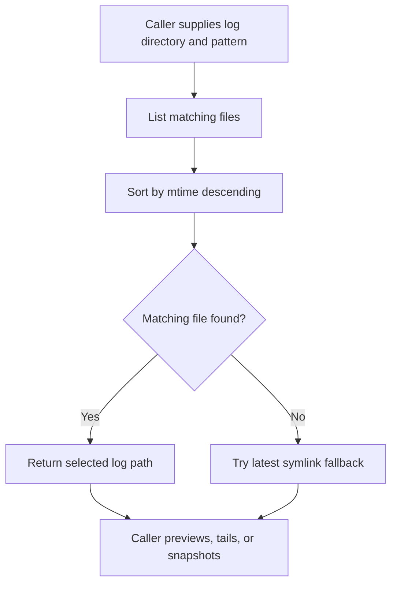

# @gg-utils/platform-logs-core

Product-neutral platform log discovery, numeric parsing, token budget, validation, and tail-process
primitives.

Use this package when you need reusable log-file selection and tail subprocess helpers without
embedding project-specific log labels, directories, or command names.

## Install

```bash
npm install @gg-utils/platform-logs-core@git+https://github.com/gg-utils/platform-logs-core.git#main
```

Pinned dependency example:

```json
{
  "dependencies": {
    "@gg-utils/platform-logs-core": "git+https://github.com/gg-utils/platform-logs-core.git#24fcbb7"
  }
}
```

## When To Use

- You need to discover the newest log file matching a simple basename pattern.
- You need token-to-character budget conversion for log previews.
- You need validated numeric env parsing for log tools.
- You need to spawn and manage a `tail` process from a higher-level UI or CLI.

## Public Surfaces

| Import | Purpose |
|---|---|
| `@gg-utils/platform-logs-core/discover-log-files` | Mtime-sorted log discovery helpers. |
| `@gg-utils/platform-logs-core/tail-process` | Tail subprocess helpers. |
| `@gg-utils/platform-logs-core/tokens-to-char-budget` | Token count to character budget conversion. |
| `@gg-utils/platform-logs-core/parse-env-number` | Env number parsing helpers. |
| `@gg-utils/platform-logs-core/validation` | Shared validation helpers. |

## Quick Start

```ts
import {
  logTail_resolveLatestLogFile,
  logTail_tokensToCharBudget,
} from "@gg-utils/platform-logs-core";

const latest = logTail_resolveLatestLogFile({
  directory: "/workspace/logs",
  basenamePattern: "app-*.log",
  latestSymlinkPath: "/workspace/logs/latest.log",
});

const maxChars = logTail_tokensToCharBudget(1200, 4);
console.log({ latest, maxChars });
```

## Operational Flow



## Development

```bash
git clone https://github.com/gg-utils/platform-logs-core.git
cd platform-logs-core
npm run type-check
npm test
npm run build
```

The current scripts expect a source-first workspace toolchain.

## Layout

```text
.
|-- src/discover-log-files.ts
|-- src/tail-process.ts
|-- src/tokens-to-char-budget.ts
|-- src/parse-env-number.ts
|-- src/validation.ts
|-- dist/
`-- package.json
```

## Caveats

- Glob support is intentionally small: a single `*` in a basename pattern.
- This package does not know which logs are meaningful for a project.
- Higher-level UI, labels, command aliases, and retention policy belong in adapters.

## Use from another repository

Requires Node `>=22.0.0 <27`. Add this dependency; built JavaScript and declarations are included, with no install build step:

```json
"@gg-utils/platform-logs-core": "git+https://github.com/gg-utils/platform-logs-core.git#v0.2.0"
```
